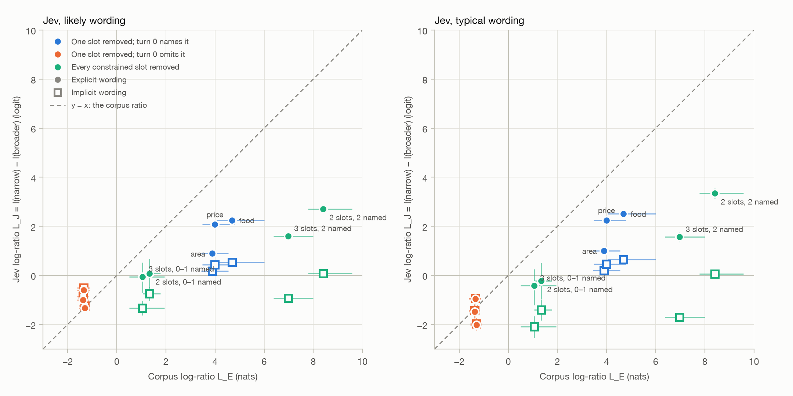

# MultiWOZ size-principle test: Jev's scores against corpus likelihood ratios

Claim under test: a likelihood obeys the size principle. If the user's first turn names a slot value, a goal that constrains that slot must beat a goal with no preference about it by the ratio real users show, ln(a/b). Jev's scores are elicited yes-probabilities read on the logit scale. The corpus ratios come from MultiWOZ users.

## 1. Setup and counts

- Corpus: MultiWOZ 2.1 goals and 2.2 turn annotations at commit `fe0c8e65cfcd`, 10,438 and 10,437 dialogues.
- Items: first user turns of single-domain restaurant dialogues (SNG) with a slot-based goal: 235 clean and 135 with fail_info (72 name-based goals excluded). The clean set is the primary analysis.
- Hypotheses: the goal, the goal minus each constrained slot, and the broad goal, each in an implicit wording and an explicit wording that adds "The user has no preference about ...", plus contradiction and tie controls. One hypothesis per call. Run `20261026T034616Z-full`: 7,454 scores from `jev-1.13.0` (every response reported `jev-1.13.0`), 7,032 HTTP requests, 0 failures, 0 scores clipped at 0.001.
- Repeat check, run `20261026T041814Z-repeats`, `multiwoz_likely`: each (item, hypothesis) scored 4 times. Jev is not deterministic: 33 of 302 groups were identical. The mean within-group SD is 0.058 logits and the largest range 0.41.
- Prompt versions: `multiwoz_likely`, `multiwoz_typical`; `stated_intention` is the constant `find_restaurant` and the hypothesis text is the intention description.
- Intervals: 2,000 paired bootstrap replicates. Replicate b resamples items for L_J and takes reference replicate b for L_E; for the clean set it is the very resample that produced a.

## 2. Reference table

a from `match_clean_turn0`, b from `pooled_first_restaurant_turn` with +0.5 smoothing.

| Slot | a | b | Named: ln(a/b) (95%) | Omitted: ln((1−a)/(1−b)) (95%) |
| --- | --- | --- | --- | --- |
| food | 0.728 | 0.00671 | 4.69 [4.05, 6.00] | -1.30 [-1.55, -1.09] |
| area | 0.742 | 0.01517 | 3.89 [3.44, 4.55] | -1.34 [-1.61, -1.11] |
| price | 0.750 | 0.01380 | 4.00 [3.48, 4.79] | -1.37 [-1.61, -1.16] |

All three slots named and removed: 12.57 nats. The slot-level ratio ignores which value was named. Under a no-preference goal a specific value is less likely still, so the true likelihood ratio is at least a/b. Full tables and sensitivity variants: `data/multiwoz/derived/reference_table.md`.

## 3. Headline: Occam gap

OG = mean(L_J) − L_E. Zero means Jev's breadth penalty matches the corpus; negative means Jev penalizes breadth less than real users' first turns warrant.

| Pairs | L_E (nats) | likely explicit mean L_J | OG (95%) | likely implicit mean L_J | OG (95%) | typical explicit mean L_J | OG (95%) | typical implicit mean L_J | OG (95%) |
| --- | --- | --- | --- | --- | --- | --- | --- | --- | --- |
| One named slot removed (mean over slots) | 4.19 | 1.74 | -2.45 [-3.01, -2.13] | 0.38 | -3.81 [-4.36, -3.49] | 1.92 | -2.27 [-2.84, -1.95] | 0.43 | -3.76 [-4.32, -3.44] |
| One omitted slot removed (mean over slots) | -1.34 | -0.98 | 0.36 [0.24, 0.49] | -0.87 | 0.47 [0.35, 0.59] | -1.48 | -0.15 [-0.29, 0.00] | -1.45 | -0.11 [-0.25, 0.04] |
| Every constrained slot removed, all named | 8.41 | 2.71 | -5.70 [-6.85, -5.05] | 0.07 | -8.33 [-9.49, -7.68] | 3.35 | -5.06 [-6.23, -4.40] | 0.06 | -8.35 [-9.52, -7.70] |
| Every constrained slot removed, some named | 5.99 | 1.35 | -4.64 [-5.70, -4.05] | -0.92 | -6.91 [-7.99, -6.28] | 1.27 | -4.72 [-5.78, -4.13] | -1.69 | -7.68 [-8.76, -7.04] |

With the `likely` question, removing one named slot costs the broader goal 1.74 logits under the explicit wording and 0.38 under the implicit wording, against 4.19 nats in the corpus. Removing every constrained slot when the turn names all of them costs 2.71 (explicit) and 0.07 (implicit) against 8.41 nats.

Jev's penalty is 41% of the corpus ratio for one named slot under the explicit wording and 9% under the implicit wording; for the full removal it is 32% and 1%.

Named single-slot OG under `likely` in the secondary analyses: the log mapping (-3.60 [-4.15, -3.28] explicit, -4.09 [-4.64, -3.77] implicit); the fail_info set (-2.75 [-3.32, -2.38] explicit, -3.89 [-4.47, -3.55] implicit); the reference variants (explicit / implicit: V2 -2.05 / -3.40, V3 -2.18 / -3.54, V4 -2.04 / -3.39).

Per-slot and per-bin values with intervals: `metrics.md`. Figure data: `fig_occam_likely.csv`, `fig_occam_typical.csv`.

## 4. Wording gap

Δ = l(explicit) − l(implicit) for the same breadth. The two texts share their first sentence word for word, so any gap comes from stating the absence of a preference. The target is 0.

| Scorer | n | Mean Δ (95%) | Share with abs(Δ) > 1 | Mean Δ, G | Mean Δ, minus:food | Mean Δ, minus:area | Mean Δ, minus:pricerange | Mean Δ, broad |
| --- | --- | --- | --- | --- | --- | --- | --- | --- |
| likely | 940 | -1.13 [-1.19, -1.07] | 0.51 | 0.13 | -1.16 | -0.46 | -1.14 | -2.29 |
| typical | 940 | -1.42 [-1.50, -1.34] | 0.52 | 0.03 | -1.35 | -0.58 | -1.31 | -3.00 |

## 5. Monotonicity

Counts of pairs where the broader goal strictly outscores the narrower one although the turn names every removed slot.

| Scorer | Wording | Single slot named: broader wins | Ties | Full removal, all named: broader wins | Ties |
| --- | --- | --- | --- | --- | --- |
| likely | explicit | 3/430 (0.01) | 1 | 3/106 (0.03) | 0 |
| likely | implicit | 17/430 (0.04) | 40 | 10/106 (0.09) | 12 |
| typical | explicit | 3/430 (0.01) | 2 | 3/106 (0.03) | 0 |
| typical | implicit | 10/430 (0.02) | 61 | 10/106 (0.09) | 34 |

## 6. Controls and tie offset

Contradiction: one named slot changed to another value; the goal should win. Tie: one omitted slot changed; the utterance cannot tell the two apart, so the target gap is 0.

| Scorer | Contradiction AUROC | G minus contra (95%) | by changed slot: food / area / price | G minus tie (95%) | G minus tie2 | All tie controls (95%) |
| --- | --- | --- | --- | --- | --- | --- |
| likely | 0.965 | 2.85 [2.70, 3.01] | 3.32 / 2.52 / 2.65 | 0.07 [-0.06, 0.20] | 0.06 | 0.07 [-0.05, 0.19] |
| typical | 0.958 | 3.23 [3.04, 3.42] | 3.80 / 2.76 / 3.02 | 0.09 [-0.09, 0.26] | 0.06 | 0.09 [-0.08, 0.25] |

Within each item, `likely` favours `broad` (implicit) most (mean centred score 1.17) and `broad` (explicit) least (-1.12), leaving the contradiction controls aside. The full table is in `metrics.md`.

## 7. Reverse direction

When the turn omits a constrained slot, the broader goal should win by ln((1−b)/(1−a)), about 1.3 nats per slot.

| Prompt version | Wording | n | L_E | Mean L_J | OG (95%) |
| --- | --- | --- | --- | --- | --- |
| likely | explicit | 151 | -1.34 | -0.98 | 0.36 [0.24, 0.49] |
| likely | implicit | 151 | -1.34 | -0.87 | 0.47 [0.35, 0.59] |
| typical | explicit | 151 | -1.34 | -1.48 | -0.15 [-0.29, 0.00] |
| typical | implicit | 151 | -1.34 | -1.45 | -0.11 [-0.25, 0.04] |

With `likely`, the broader goal wins by 0.98 (explicit) and 0.87 (implicit) logits against 1.34 nats: the win falls short of the corpus ratio under both wordings; with `typical`, the broader goal wins by 1.48 (explicit) and 1.45 (implicit) logits against 1.34 nats: the win is consistent with the corpus ratio under both wordings (95% intervals).

## 8. Typicality and the language model

The `typical` question gives a named single-slot OG of -2.27 [-2.84, -1.95] (explicit) and -3.76 [-4.32, -3.44] (implicit), against -2.45 [-3.01, -2.13] and -3.81 [-4.36, -3.49] for `likely`.

The language-model check (Phase 8) has not run yet. It needs a GPU and the user's approval; `scripts/multiwoz_lm_job.sh` holds the job.

## 9. Prediction scorecard

| ID | Prediction | Value (95%) | Result |
| --- | --- | --- | --- |
| P1 | Explicit, named, single-slot OG within ±1.5 nats (mean over slots, likely) | -2.45 [-3.01, -2.13] | fail |
| P2 | Implicit, named, single-slot OG ≤ −2 nats (mean over slots, likely) | -3.81 [-4.36, -3.49] | pass |
| P3 | Implicit full removal with all constrained slots named: OG ≤ −6 nats (likely) | -8.33 [-9.49, -7.68] | pass |
| P4 | Wording gap mean ≤ −1 logit (explicit penalized more than implicit; likely) | -1.13 [-1.19, -1.07] | pass |
| P5 | Tie offset |mean l(G|impl) − l(ctrl:tie)| > 0.5 logit (likely) | 0.07 [-0.06, 0.20] | fail |
| P6 | Phase 8 language-model check | n/a | pending |

## 10. Notes for Xuan

- Removing one slot the turn names costs the broader goal 1.74 logits under the explicit wording and 0.38 under the implicit wording; real users' first turns give 4.19 nats. Jev's penalty falls short of the corpus ratio under both wordings (95% intervals). The logit reading is the generous one for Jev, so a shortfall is not an artefact of the score mapping.
- Stating the absence of a preference moves the score by -1.13 logits on average at the same breadth (51% of pairs move by more than 1), while removing a named slot under the implicit wording moves it by 0.38. Jev's breadth penalty follows how breadth is worded more than the breadth itself.
- Pre-registered predictions that failed: P1 (-2.45), P5 (0.07). A failed prediction is a result; see section 9.
- Whether normalization cancels Occam's razor is still open: it needs the Phase 8 language-model run. The diagnostic is μ_h, the mean surprisal of the model's own samples for hypothesis h, against the number of slots h constrains. If μ_h rises as hypotheses broaden, T = (S − μ_h)/σ_h subtracts exactly the size penalty that the raw log-likelihood −S keeps, and the typicality scores will show L near 0 where the log-likelihood shows L ≥ 2.
