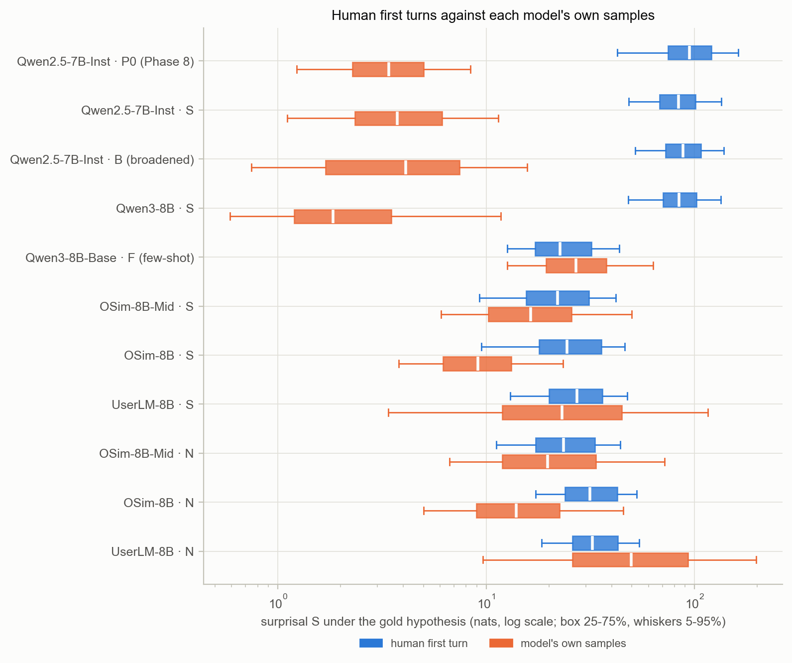
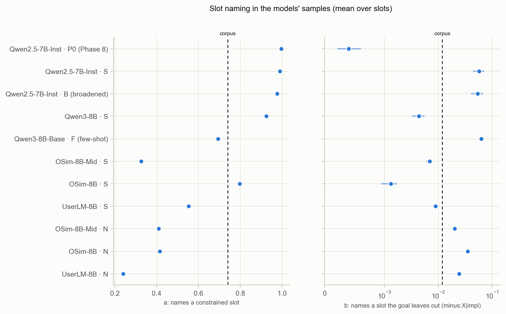
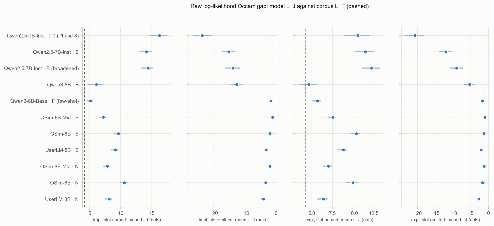
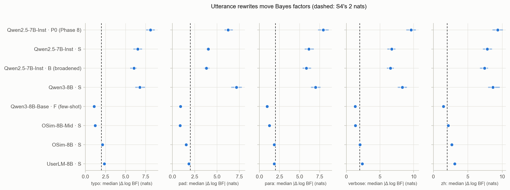
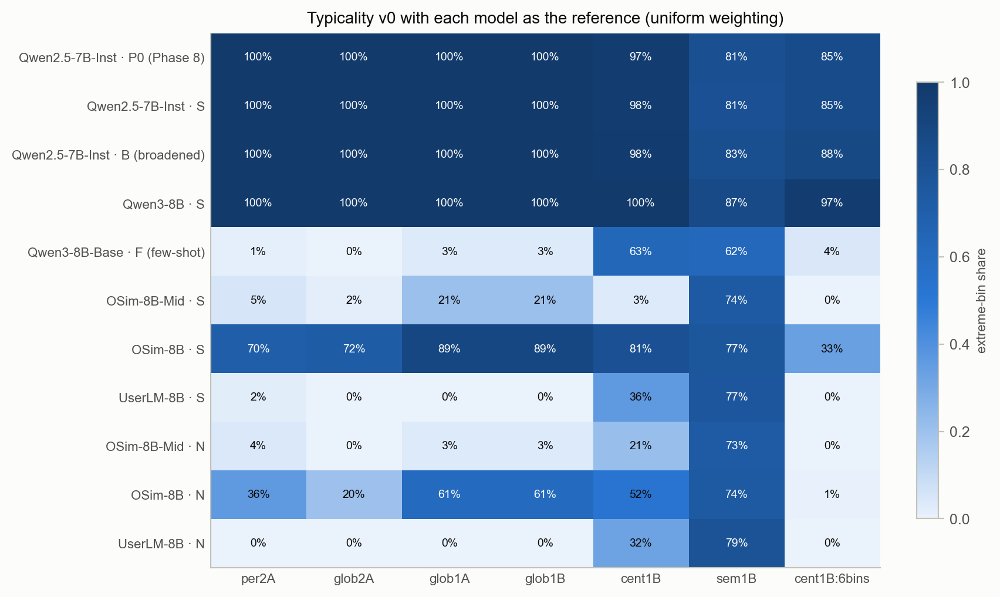
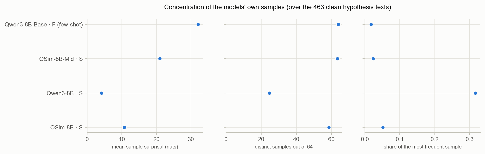

# Simulator study: which model gives human first turns a reasonable probability?

Plan: `docs/simulator_study_plan.md`; decisions and interpretations: `docs/simulator_decisions.md`; format check: `format_check.md`. Every number is on the 235 clean MultiWOZ items; brackets are 95% item-bootstrap intervals (2000 replicates, seed 20261103). S is surprisal in nats under each model's own prompt format.

Caveats: format F shows the base model 8 real human turns, an advantage the chat models do not get. `osim_final` starts from Qwen3-8B (instruct) and `osim_mid` from Qwen3-8B-Base, so mid vs final mixes the starting point with RL; the clean contrasts are base → mid and instruct → final. Rescoring noise between runs is up to about 1.4 nats (bfloat16 kernels).

## Prediction scorecard

| ID | Prediction | Result |
|---|---|---|
| S1 | osim_mid has the best coverage; the instruct models the worst | fail |
| S2 | osim_final's mean sample surprisal >= 30% below osim_mid's, and its coverage worse | **pass** |
| S3 | osim_mid names slots at corpus rates (a within 0.10, b within x3); instruct models a >= 0.9 | fail |
| S4 | claim 1 holds for every model: median \|delta log BF\| under para and zh > 2 nats | fail |
| S5 | with osim_mid as reference, global one-sided typicality (glob1A) puts < 50% of human pairs in its extreme bin | **pass** |
| S6 | osim_mid beats userlm on coverage; qwen25_broad beats qwen25_inst but stays below osim_mid | fail |

Values behind each verdict are in `metrics.json` under `predictions`.

## Sample health

Over the 64 samples of each of the 463 clean hypothesis texts. Cut off: no end marker within 96 tokens (kept with a lower bound on S). Empty: the model ended the turn at once. Phase 8 (P0) dropped its cut-off samples, so its rate is not recorded.

| Model · format | cut off | empty | <\|endconversation\|> | "Sure…"-type opening |
|---|---|---|---|---|
| Qwen2.5-7B-Inst · P0 (Phase 8) | – | 0.0% | – | – |
| Qwen2.5-7B-Inst · S | 0.0% | 0.0% | 0.0% | 0.0% |
| Qwen2.5-7B-Inst · B (broadened) | 0.0% | 0.0% | 0.0% | 0.0% |
| Qwen3-8B · S | 0.1% | 0.0% | 0.0% | 0.0% |
| Qwen3-8B-Base · F (few-shot) | 0.0% | 0.4% | 0.0% | 1.0% |
| OSim-8B-Mid · S | 0.1% | 0.0% | 0.0% | 0.4% |
| OSim-8B · S | 0.0% | 0.0% | 0.0% | 0.0% |
| UserLM-8B · S | 7.1% | 6.5% | 2.0% | 0.2% |
| OSim-8B-Mid · N (sensitivity) | 0.6% | 0.0% | 0.0% | 6.1% |
| OSim-8B · N (sensitivity) | 1.4% | 0.0% | 0.0% | 35.7% |
| UserLM-8B · N (sensitivity) | 36.6% | 0.9% | 7.7% | 0.5% |

## Q1 Coverage

Human percentile: the share of a hypothesis's own samples at least as surprising as the human turn (0 = beyond all samples). z: the human turn's standardized gap (S − μ_H)/σ_H.

| Model · format | median percentile | beyond all samples | percentile < 0.05 | gold: beyond all | median z | z p90 |
|---|---|---|---|---|---|---|
| Qwen2.5-7B-Inst · P0 (Phase 8) | 0.000 [0.000, 0.000] | 99.9% [99.8%, 100.0%] | 100.0% [99.9%, 100.0%] | 99.6% [98.7%, 100.0%] | 37.6 [36.1, 39.0] | 69.5 |
| Qwen2.5-7B-Inst · S | 0.000 [0.000, 0.000] | 99.8% [99.7%, 100.0%] | 100.0% [99.9%, 100.0%] | 100.0% [100.0%, 100.0%] | 19.5 [18.6, 20.3] | 40.7 |
| Qwen2.5-7B-Inst · B (broadened) | 0.000 [0.000, 0.000] | 96.1% [95.2%, 97.1%] | 99.9% [99.8%, 100.0%] | 99.1% [97.9%, 100.0%] | 14.3 [13.6, 14.9] | 28.3 |
| Qwen3-8B · S | 0.000 [0.000, 0.000] | 100.0% [100.0%, 100.0%] | 100.0% [100.0%, 100.0%] | 100.0% [100.0%, 100.0%] | 22.1 [21.3, 23.0] | 47.2 |
| Qwen3-8B-Base · F (few-shot) | 0.453 [0.422, 0.484] | 0.2% [0.0%, 0.5%] | 1.4% [0.5%, 2.7%] | 0.0% [0.0%, 0.0%] | -0.1 [-0.2, -0.1] | 0.9 |
| OSim-8B-Mid · S | 0.219 [0.203, 0.234] | 0.7% [0.2%, 1.3%] | 7.5% [5.3%, 9.9%] | 0.4% [0.0%, 1.3%] | 0.5 [0.4, 0.6] | 1.7 |
| OSim-8B · S | 0.016 [0.016, 0.016] | 37.6% [34.1%, 41.1%] | 75.2% [71.9%, 78.5%] | 19.6% [14.5%, 24.7%] | 3.1 [2.9, 3.4] | 6.7 |
| UserLM-8B · S | 0.344 [0.328, 0.365] | 0.0% [0.0%, 0.0%] | 0.0% [0.0%, 0.1%] | 0.0% [0.0%, 0.0%] | 0.0 [-0.0, 0.1] | 1.0 |
| OSim-8B-Mid · N (sensitivity) | 0.266 [0.250, 0.281] | 0.4% [0.2%, 0.7%] | 5.9% [4.4%, 7.4%] | 0.0% [0.0%, 0.0%] | 0.2 [0.1, 0.2] | 1.3 |
| OSim-8B · N (sensitivity) | 0.094 [0.078, 0.094] | 6.5% [5.2%, 8.0%] | 35.9% [32.8%, 39.3%] | 2.6% [0.9%, 4.7%] | 1.5 [1.4, 1.6] | 4.0 |
| UserLM-8B · N (sensitivity) | 0.734 [0.719, 0.750] | 0.0% [0.0%, 0.0%] | 0.0% [0.0%, 0.0%] | 0.0% [0.0%, 0.0%] | -0.5 [-0.5, -0.5] | -0.1 |

Surprisal per word under the gold hypothesis, and semantic coverage (does any of the gold hypothesis's samples carry the human turn's annotated slot tuple?):

| Model · format | S/word, human | S/word, samples | slot tuple covered | median P_sem |
|---|---|---|---|---|
| Qwen2.5-7B-Inst · P0 (Phase 8) | 7.18 [6.78, 7.48] | 0.19 [0.18, 0.19] | 47.7% [41.3%, 54.0%] | 0.008 [0.008, 0.054] |
| Qwen2.5-7B-Inst · S | 6.49 [6.20, 6.83] | 0.18 [0.17, 0.18] | 55.7% [49.4%, 61.7%] | 0.023 [0.008, 0.115] |
| Qwen2.5-7B-Inst · B (broadened) | 6.80 [6.56, 7.28] | 0.20 [0.19, 0.21] | 58.7% [51.9%, 64.7%] | 0.069 [0.023, 0.177] |
| Qwen3-8B · S | 6.52 [6.19, 6.75] | 0.09 [0.09, 0.10] | 49.4% [43.0%, 55.7%] | 0.008 [0.008, 0.117] |
| Qwen3-8B-Base · F (few-shot) | 1.80 [1.67, 1.88] | 2.14 [2.12, 2.17] | 97.0% [94.9%, 98.7%] | 0.177 [0.131, 0.269] |
| OSim-8B-Mid · S | 1.70 [1.65, 1.77] | 1.50 [1.48, 1.52] | 91.5% [87.7%, 94.9%] | 0.131 [0.100, 0.162] |
| OSim-8B · S | 1.92 [1.86, 2.06] | 0.68 [0.67, 0.70] | 90.2% [86.4%, 93.6%] | 0.177 [0.115, 0.254] |
| UserLM-8B · S | 2.12 [1.99, 2.23] | 2.35 [2.30, 2.39] | 83.4% [78.7%, 88.1%] | 0.095 [0.070, 0.319] |
| OSim-8B-Mid · N (sensitivity) | 1.83 [1.79, 1.94] | 2.05 [2.02, 2.09] | 88.9% [84.7%, 92.8%] | 0.131 [0.085, 0.146] |
| OSim-8B · N (sensitivity) | 2.41 [2.30, 2.55] | 1.04 [1.03, 1.06] | 75.7% [69.8%, 81.3%] | 0.131 [0.100, 0.183] |
| UserLM-8B · N (sensitivity) | 2.54 [2.44, 2.69] | 3.39 [3.36, 3.45] | 70.6% [64.3%, 76.6%] | 0.056 [0.042, 0.069] |

Style: each human turn against one sample under its gold hypothesis (235 each). Outside vocabulary: a word not among those in at least 5 MultiWOZ 2.2 train dialogues; for people this is mostly typos, for the simulators mostly content MultiWOZ users never mention (birthday, romantic, anniversary, a city).

| Text | median words | greeting | question | word outside vocabulary | distinct-2 |
|---|---|---|---|---|---|
| **human turns** | 13 | 17.4% | 26.8% | 1.7% | 0.232 |
| Qwen2.5-7B-Inst · P0 (Phase 8) | 18 | 97.0% | 100.0% | 0.0% | 0.045 |
| Qwen2.5-7B-Inst · S | 20 | 100.0% | 100.0% | 0.0% | 0.054 |
| Qwen2.5-7B-Inst · B (broadened) | 20 | 100.0% | 100.0% | 3.0% | 0.069 |
| Qwen3-8B · S | 20 | 100.0% | 100.0% | 4.3% | 0.072 |
| Qwen3-8B-Base · F (few-shot) | 12 | 9.4% | 51.5% | 16.6% | 0.223 |
| OSim-8B-Mid · S | 12 | 35.3% | 27.7% | 25.5% | 0.196 |
| OSim-8B · S | 15 | 23.4% | 25.1% | 6.4% | 0.091 |
| UserLM-8B · S | 11 | 11.9% | 16.2% | 37.4% | 0.286 |
| OSim-8B-Mid · N (sensitivity) | 10 | 4.7% | 59.1% | 27.7% | 0.274 |
| OSim-8B · N (sensitivity) | 15 | 6.4% | 94.9% | 18.7% | 0.190 |
| UserLM-8B · N (sensitivity) | 15 | 0.4% | 8.5% | 91.5% | 0.388 |

## Q2 Fidelity

Slot naming in the samples, mean over the three slots (a: under the gold hypothesis, a constrained slot is named; b: under minus:X, the left-out slot X is named).

| Model · format | a | b (impl) | b (expl) |
|---|---|---|---|
| **corpus** | 0.740 | 0.0119 | – |
| Qwen2.5-7B-Inst · P0 (Phase 8) | 0.996 [0.995, 0.997] | 0.0004 [0.0002, 0.0006] | 0.0100 [0.0087, 0.0113] |
| Qwen2.5-7B-Inst · S | 0.989 [0.986, 0.992] | 0.0578 [0.0444, 0.0718] | 0.0340 [0.0307, 0.0372] |
| Qwen2.5-7B-Inst · B (broadened) | 0.976 [0.973, 0.979] | 0.0542 [0.0409, 0.0682] | 0.0779 [0.0715, 0.0845] |
| Qwen3-8B · S | 0.925 [0.911, 0.939] | 0.0044 [0.0033, 0.0056] | 0.0087 [0.0072, 0.0100] |
| Qwen3-8B-Base · F (few-shot) | 0.694 [0.686, 0.702] | 0.0631 [0.0609, 0.0652] | 0.0501 [0.0476, 0.0525] |
| OSim-8B-Mid · S | 0.326 [0.319, 0.335] | 0.0069 [0.0060, 0.0078] | 0.0077 [0.0070, 0.0084] |
| OSim-8B · S | 0.798 [0.790, 0.805] | 0.0013 [0.0009, 0.0017] | 0.0018 [0.0013, 0.0022] |
| UserLM-8B · S | 0.554 [0.540, 0.568] | 0.0089 [0.0080, 0.0100] | 0.0215 [0.0198, 0.0233] |
| OSim-8B-Mid · N (sensitivity) | 0.410 [0.399, 0.422] | 0.0202 [0.0184, 0.0221] | 0.0455 [0.0429, 0.0483] |
| OSim-8B · N (sensitivity) | 0.415 [0.405, 0.426] | 0.0352 [0.0329, 0.0377] | 0.0504 [0.0477, 0.0530] |
| UserLM-8B · N (sensitivity) | 0.241 [0.232, 0.249] | 0.0244 [0.0220, 0.0267] | 0.0695 [0.0657, 0.0733] |

Per slot ln(a/b) (implicit wording) against the corpus:

| Model · format | area (corpus) | food (corpus) | pricerange (corpus) |
|---|---|---|---|
| Qwen2.5-7B-Inst · P0 (Phase 8) | 6.64 (3.89) | 10.12 (4.69) | 10.14 (4.00) |
| Qwen2.5-7B-Inst · S | 1.74 (3.89) | 6.32 (4.69) | 5.47 (4.00) |
| Qwen2.5-7B-Inst · B (broadened) | 1.92 (3.89) | 5.66 (4.69) | 3.93 (4.00) |
| Qwen3-8B · S | 4.86 (3.89) | 10.04 (4.69) | 5.01 (4.00) |
| Qwen3-8B-Base · F (few-shot) | 2.77 (3.89) | 2.80 (4.69) | 1.84 (4.00) |
| OSim-8B-Mid · S | 4.52 (3.89) | 3.37 (4.69) | 4.29 (4.00) |
| OSim-8B · S | 6.35 (3.89) | 5.93 (4.69) | 7.61 (4.00) |
| UserLM-8B · S | 3.94 (3.89) | 3.67 (4.69) | 5.98 (4.00) |
| OSim-8B-Mid · N (sensitivity) | 3.51 (3.89) | 2.56 (4.69) | 3.44 (4.00) |
| OSim-8B · N (sensitivity) | 3.75 (3.89) | 2.38 (4.69) | 2.02 (4.00) |
| UserLM-8B · N (sensitivity) | 2.81 (3.89) | 1.65 (4.69) | 4.54 (4.00) |

Raw log-likelihood Occam gap (scores −S; `metrics.py`): the model's mean L_J against the corpus L_E, mean over slots.

| Model · format | impl named | impl omitted | expl named | expl omitted | expl − impl wording gap |
|---|---|---|---|---|---|
| Qwen2.5-7B-Inst · P0 (Phase 8) | 16.23 vs 4.19 | -23.68 vs -1.34 | 10.58 vs 4.19 | -20.76 vs -1.34 | 0.12 |
| Qwen2.5-7B-Inst · S | 14.13 vs 4.19 | -15.24 vs -1.34 | 11.47 vs 4.19 | -12.04 vs -1.34 | -1.24 |
| Qwen2.5-7B-Inst · B (broadened) | 14.42 vs 4.19 | -13.86 vs -1.34 | 12.22 vs 4.19 | -9.00 vs -1.34 | -1.03 |
| Qwen3-8B · S | 6.08 vs 4.19 | -12.71 vs -1.34 | 4.64 vs 4.19 | -5.36 vs -1.34 | -4.01 |
| Qwen3-8B-Base · F (few-shot) | 5.15 vs 4.19 | -1.70 vs -1.34 | 5.69 vs 4.19 | -1.71 vs -1.34 | -0.30 |
| OSim-8B-Mid · S | 7.20 vs 4.19 | -1.14 vs -1.34 | 7.55 vs 4.19 | -1.03 vs -1.34 | -0.30 |
| OSim-8B · S | 9.64 vs 4.19 | -1.98 vs -1.34 | 10.39 vs 4.19 | -1.30 vs -1.34 | -1.08 |
| UserLM-8B · S | 9.14 vs 4.19 | -3.22 vs -1.34 | 8.84 vs 4.19 | -2.14 vs -1.34 | -0.67 |
| OSim-8B-Mid · N (sensitivity) | 7.84 vs 4.19 | -2.00 vs -1.34 | 7.02 vs 4.19 | -1.27 vs -1.34 | 0.17 |
| OSim-8B · N (sensitivity) | 10.58 vs 4.19 | -3.32 vs -1.34 | 9.97 vs 4.19 | -1.69 vs -1.34 | -0.40 |
| UserLM-8B · N (sensitivity) | 8.13 vs 4.19 | -4.08 vs -1.34 | 6.39 vs 4.19 | -2.74 vs -1.34 | -0.34 |

## Q3 Robustness (claim 1 with each model)

| Model · format | ICC(1) | within/between SD | \|ΔBF\| typo | \|ΔBF\| pad | \|ΔBF\| para | \|ΔBF\| verbose | \|ΔBF\| zh | flip (para) | SD of P(G) | argmax flip |
|---|---|---|---|---|---|---|---|---|---|---|
| Qwen2.5-7B-Inst · P0 (Phase 8) | 0.74 | 0.54 [0.51, 0.58] | 8.1 | 6.2 | 7.9 | 9.6 | 9.4 | 14.7% | 0.161 [0.137, 0.184] | 25.2% |
| Qwen2.5-7B-Inst · S | 0.79 | 0.46 [0.44, 0.50] | 6.5 | 4.0 | 6.1 | 6.8 | 7.8 | 11.9% | 0.170 [0.146, 0.193] | 23.3% |
| Qwen2.5-7B-Inst · B (broadened) | 0.83 | 0.43 [0.41, 0.47] | 6.0 | 3.8 | 5.8 | 6.5 | 7.4 | 11.7% | 0.131 [0.110, 0.153] | 19.0% |
| Qwen3-8B · S | 0.51 | 0.84 [0.79, 0.88] | 6.8 | 7.2 | 7.0 | 8.3 | 8.7 | 23.9% | 0.246 [0.224, 0.267] | 41.9% |
| Qwen3-8B-Base · F (few-shot) | 0.94 | 0.24 [0.22, 0.26] | 1.1 | 0.9 | 1.0 | 1.3 | 1.5 | 2.0% | 0.095 [0.085, 0.104] | 7.1% |
| OSim-8B-Mid · S | 0.90 | 0.27 [0.26, 0.29] | 1.2 | 0.9 | 1.2 | 1.3 | 2.2 | 3.0% | 0.167 [0.152, 0.183] | 16.9% |
| OSim-8B · S | 0.90 | 0.27 [0.26, 0.29] | 2.1 | 1.5 | 1.9 | 2.0 | 2.7 | 2.8% | 0.148 [0.132, 0.164] | 14.8% |
| UserLM-8B · S | 0.83 | 0.36 [0.33, 0.38] | 2.3 | 1.8 | 1.9 | 2.4 | 3.1 | 2.8% | 0.200 [0.182, 0.217] | 19.0% |

## Q4 Typicality

Share of human pairs in the extreme bin, per typicality v0 variant, with this model as the reference (uniform weighting; `cent1B:6bins` is cent1B with the 6-bin edges).

| Model · format | per2A | glob2A | glob1A | glob1B | cent1B | sem1B | cent1B:6bins |
|---|---|---|---|---|---|---|---|
| Qwen2.5-7B-Inst · P0 (Phase 8) | 100.0% | 100.0% | 100.0% | 100.0% | 97.5% | 81.5% | 85.4% |
| Qwen2.5-7B-Inst · S | 100.0% | 100.0% | 100.0% | 100.0% | 97.6% | 80.7% | 85.5% |
| Qwen2.5-7B-Inst · B (broadened) | 99.9% | 100.0% | 100.0% | 100.0% | 97.8% | 82.5% | 87.6% |
| Qwen3-8B · S | 100.0% | 100.0% | 100.0% | 100.0% | 99.8% | 86.7% | 96.6% |
| Qwen3-8B-Base · F (few-shot) | 1.2% | 0.4% | 3.4% | 3.4% | 63.2% | 62.3% | 4.4% |
| OSim-8B-Mid · S | 5.4% | 1.7% | 20.6% | 20.6% | 3.4% | 73.6% | 0.0% |
| OSim-8B · S | 70.4% | 72.1% | 88.9% | 88.9% | 80.6% | 77.3% | 33.4% |
| UserLM-8B · S | 2.3% | 0.0% | 0.3% | 0.3% | 36.0% | 76.9% | 0.0% |
| OSim-8B-Mid · N (sensitivity) | 3.9% | 0.3% | 3.4% | 3.4% | 21.2% | 73.0% | 0.0% |
| OSim-8B · N (sensitivity) | 36.1% | 20.3% | 60.6% | 60.6% | 52.4% | 74.1% | 0.6% |
| UserLM-8B · N (sensitivity) | 0.0% | 0.0% | 0.0% | 0.0% | 32.3% | 79.4% | 0.0% |

Size principle kept (L_J ÷ L_E, implicit, slot named), contradiction log Bayes factor, and bin agreement under the para rewrites:

| Model · format | glob1B | cent1B | sem1B |
|---|---|---|---|
| Qwen2.5-7B-Inst · P0 (Phase 8) | 0.01 / 0.0 / 99.9% | 0.40 / 1.5 / 95.2% | 0.14 / 0.5 / 100.0% |
| Qwen2.5-7B-Inst · S | 0.00 / 0.0 / 100.0% | 0.34 / 1.4 / 94.9% | 0.16 / 0.7 / 100.0% |
| Qwen2.5-7B-Inst · B (broadened) | 0.00 / 0.0 / 100.0% | 0.36 / 1.5 / 95.9% | 0.19 / 0.8 / 100.0% |
| Qwen3-8B · S | 0.00 / 0.0 / 100.0% | 0.02 / 0.1 / 99.4% | 0.19 / 0.8 / 100.0% |
| Qwen3-8B-Base · F (few-shot) | 1.10 / 5.2 / 74.9% | 1.18 / 5.3 / 86.4% | 0.51 / 2.0 / 100.0% |
| OSim-8B-Mid · S | 1.75 / 7.1 / 66.2% | 1.79 / 6.6 / 84.4% | 0.20 / 0.8 / 100.0% |
| OSim-8B · S | 0.51 / 2.0 / 87.1% | 1.62 / 6.2 / 90.0% | 0.27 / 1.1 / 100.0% |
| UserLM-8B · S | 2.51 / 8.8 / 79.6% | 1.95 / 6.3 / 84.5% | 0.27 / 1.1 / 100.0% |
| OSim-8B-Mid · N (sensitivity) | 1.92 / 5.6 / – | 1.87 / 6.8 / – | 0.28 / 1.1 / – |
| OSim-8B · N (sensitivity) | 1.61 / 4.8 / – | 2.46 / 7.4 / – | 0.27 / 1.1 / – |
| UserLM-8B · N (sensitivity) | 0.27 / 0.5 / – | 1.59 / 4.4 / – | 0.18 / 0.7 / – |

## Q5 What RL does

Concentration over the 463 clean hypothesis texts:

| Model · format | mean sample S | distinct of 64 | top sample share |
|---|---|---|---|
| Qwen2.5-7B-Inst · P0 (Phase 8) | 4.5 | 34.2 | 20.4% |
| Qwen2.5-7B-Inst · S | 6.4 | 41.9 | 15.0% |
| Qwen2.5-7B-Inst · B (broadened) | 7.6 | 42.6 | 20.2% |
| Qwen3-8B · S | 4.1 | 24.7 | 31.6% |
| Qwen3-8B-Base · F (few-shot) | 32.1 | 63.8 | 1.8% |
| OSim-8B-Mid · S | 21.0 | 63.3 | 2.4% |
| OSim-8B · S | 10.7 | 58.5 | 5.2% |
| UserLM-8B · S | 37.9 | 60.1 | 6.9% |
| OSim-8B-Mid · N (sensitivity) | 27.8 | 63.5 | 2.2% |
| OSim-8B · N (sensitivity) | 19.6 | 62.6 | 3.0% |
| UserLM-8B · N (sensitivity) | 69.5 | 63.5 | 2.3% |

Paired differences (second − first, the same item draws):

| Pair | median percentile | share beyond all | mean μ_H | gold median z |
|---|---|---|---|---|
| osim_final\|S - osim_mid\|S | -0.203 [-0.219, -0.188] | 0.369 [0.336, 0.404] | -10.059 [-10.138, -9.984] | 1.901 [1.609, 2.256] |
| osim_final\|S - qwen3_inst\|S | 0.016 [0.016, 0.016] | -0.624 [-0.659, -0.589] | 4.694 [4.516, 4.873] | -26.954 [-29.602, -25.042] |
| osim_mid\|S - qwen3_base\|F | -0.234 [-0.250, -0.219] | 0.005 [0.001, 0.010] | -9.464 [-9.608, -9.326] | 0.544 [0.435, 0.608] |

Ten samples for the same goal (SNG01165):

**OSim-8B-Mid · S**

1. Hello, I type to booking a table for dinner.
2. Thank you. I am looking for an italian restaurant not too expensive with a little bit of a town center location.
3. can you recommend a restaurant with reasonable price?
4. Can you book me a table in a restaurant?
5. I want to book a table.
6. I would like to locate a moderately priced Italian restaurant.
7. Can you suggest a restaurant serving Italian food?
8. Where is a good restaurant that is moderately priced?
9. I'm looking for a restaurant to eat at.
10. A table near the back of the restaurant

**OSim-8B · S**

1. I’m looking for a moderately priced Italian restaurant in the east side of town.
2. I am looking for a restaurant that serves italian food.
3. can you recommend a restaurant with moderate price range and with italian food?
4. Can you help me find a moderately priced restaurant serving italian food in the east of town?
5. I want to book a table.คณะกรรม
6. I would like to find a moderately priced Italian restaurant in the east end of town.
7. Can you suggest a restaurant serving Italian food in the East of town?
8. I'm looking for a moderately priced restaurant serving italian food in the east of town.
9. I'm looking for a restaurant to book a table for dinner. Can you help me find one that serves Italian food?
10. I want to find a moderately priced restaurant serving Italian food in the east of town

## Recommendation

**For pipeline v0, use Qwen3-8B-Base with the few-shot format F as the reference model, and
OSim-8B-Mid with format S as the zero-shot second reference.** Do not use an instruct model, under
any prompt, or the RL-trained OSim-8B as a likelihood reference.

Why Qwen3-8B-Base · F:
- **Coverage is the best of all models.** The median human percentile is 0.45, so a human turn is about
  as surprising as the model's typical sample. 0.2% of pairs lie beyond all 64 samples.
- **Corpus fidelity is the closest.** It names constrained slots at 0.69 (corpus 0.74). Its raw Occam
  gap is 5.2 vs 4.2 nats for a named slot and −1.7 vs −1.3 for an omitted one; Phase 8's was 16.2 and −23.7.
- **It is the most robust and its samples are clean.** Median |Δ log BF| is 1.0 nats under
  paraphrase. 0.4% of samples are empty and none are cut off.
- **Typicality works again with it as the reference.** glob1A puts 3.4% of human pairs in its extreme bin
  (Qwen: 100%) and keeps the size principle (L_J ÷ L_E 1.10).

Its weaknesses:
- **It over-names left-out slots.** It names a slot that the hypothesis leaves out in 6.3% of samples
  (corpus 1.2%).
- **It sees eight real MultiWOZ first turns,** which the chat models do not. For a MultiWOZ pipeline
  that is a legitimate design choice (the examples come from non-probe training dialogues). It is still an
  advantage in this comparison, and another domain needs its own examples.

Why OSim-8B-Mid · S as the second reference:
- **It gives human first turns the most probability of any model.** That is 1.70 nats per word, against
  1.80 for F and 6.5–7.2 for the instruct models.
- **It covers human turns without in-context examples.** The median percentile is 0.22, and 0.7% of
  pairs lie beyond all samples.
- **Its b is at the corpus rate** (0.007 vs 0.012), and its omitted-slot Occam term matches (−1.1 vs −1.3).

Its weakness is that it under-names constrained slots (a = 0.33 vs 0.74). Its samples are often
vaguer than the goal ("I'm looking for a restaurant to eat at.").

UserLM-8B · S has the best zero-shot coverage numbers: no pair lies beyond all samples. Part of that
comes from a very broad distribution:
- 7.1% of its samples run past 96 tokens into unrelated text.
- 6.5% are empty turns.
- 37% contain a word outside the MultiWOZ vocabulary.
- Its raw Occam gap is 2.2 times the corpus value.

It is a reasonable third model to check results against, not a reference.

## Notes for Xuan

1. **The direction holds.** Base and simulator models give human first turns reasonable probability:
   1.7–2.1 nats per word, against 6.5–7.2 for Qwen2.5-7B-Instruct and Qwen3-8B. Human turns fall inside
   the samples of the base model, OSim-8B-Mid and UserLM (0–0.7% beyond all 64), against 96–100% for the
   instruct models. OSim-8B, the RL model, sits between them at 38%.
2. **Prompting does not fix an instruct model.** The broadened prompt B ("real people write in many
   different ways…") moves Qwen2.5's share beyond all samples only from 99.8% to 96.1%.
3. **RL narrows the distribution again (S2 holds).** OSim-8B's samples are half as surprising as
   OSim-8B-Mid's (10.7 vs 21.0 nats), and 38% of human pairs fall beyond all its samples (Mid: 0.7%).
   The final model starts from Qwen3-8B, the instruct model, while Mid starts from the base model, so this
   mixes RL with the starting point. Measured from its own start, OSim training widens Qwen3-8B a great
   deal: the share beyond all samples falls from 100% to 38%.
4. **No model matches the corpus on both slot-naming rates.** The instruct models name almost every
   constrained slot (a = 0.92–0.99), which is the Occam overshoot found earlier. The base model is
   closest on a, and OSim-8B-Mid and UserLM are closest on b. The corpus rates are a = 0.74 and b = 0.012.
5. **Claim 1 is much weaker with human-like models (S4 fails).** The median |Δ log BF| under
   paraphrase is 1–2 nats for the base and simulator models, up to 3 under translation into Chinese.
   For the instruct models it is 6–8 nats.
   - The large shifts in claim 1 are a property of the instruct models' narrow distributions.
   - **The 1–2 nats are real, not rescoring noise** ([noise_floor.md](noise_floor.md)). The check
     rescored every rewrite pair with the original utterance put back. The resulting noise in
     |Δ log BF| has a median of 0.15–0.21 nats for the base and simulator models (0.31–0.47 for the
     instruct models). That counts only pairs whose batch layout changed; the others reproduce their
     scores bit for bit.
   - For the base and simulator models, 62–85% of real paraphrase shifts lie above the noise's 95th
     percentile.
   - Noise only adds to |Δ|, so S4's failure is not a noise artifact. The noise-free shifts are, if
     anything, a little smaller.
   - Rescoring in the same layout reproduces Phase 2 exactly, so the runs are deterministic. The
     noise comes only from batch layout (padding width and batch size in bfloat16).
   - The claims draft should state claim 1 for the likelihoods it was measured with, or restate it with
     these results: about 1–2 nats under paraphrase with human-like models, and 6–8 with instruct models.
6. **Typicality regains signal with a human-like reference (S5 holds).** With the base model, OSim-8B-Mid
   or UserLM as the reference, glob1A puts 0.3–21% of human pairs in its extreme bin, against 100% with
   Qwen. The size principle survives (L_J ÷ L_E 1.1–2.5, against 0.0). The semantic variant sem1B stays at
   62–87% for every model: its limit is the regex slot tuple, not the model.
7. **What failed in the scorecard.**
   - S1 and S6: OSim-8B-Mid is third on coverage, behind the few-shot base model and UserLM.
   - S3: OSim-8B-Mid's a is far below the corpus rate.
   - S4: as in note 5.
   - The other half of S6 holds: the broadened prompt helps Qwen2.5 a little and stays far below
     OSim-8B-Mid.
8. **Caveats.**
   - One seed; first turns only; the restaurant domain; 64 samples per hypothesis; bfloat16 on H100 MIG
     slices.
   - Format F's eight examples.
   - The N sensitivity runs agree with S for OSim-8B-Mid (median percentile 0.27 vs 0.22). Under N,
     OSim-8B often answers as the assistant (36% of samples), and UserLM drifts off topic (37% cut off).
     So S was the right primary format.
9. **The ranking holds at later turns (Phase 5 pilot, [pilot/pilot.md](pilot/pilot.md)).** User turns 2
   and 3 of 60 dialogues were given the real history in the prompt.
   - The coverage order is the same as at turn 1, except that OSim-8B-Mid and UserLM swap at turn 3
     within their intervals.
   - The instruct models stay at a median percentile of 0.
   - OSim-8B-Mid's median percentile rises from 0.19 to 0.38.
   - OSim-8B's share beyond all samples falls from 52% to 15–17%, so RL's narrowing is mostly a
     first-turn effect.
10. **Next.** Nothing from the plan is pending. A multi-turn version of the few-shot format F
    would be needed to test Qwen3-8B-Base on later turns.
